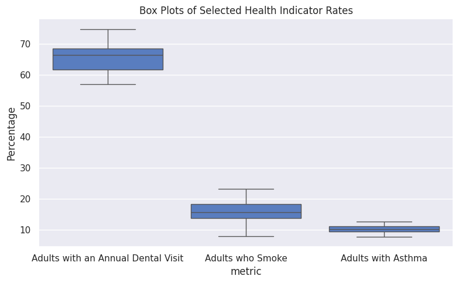
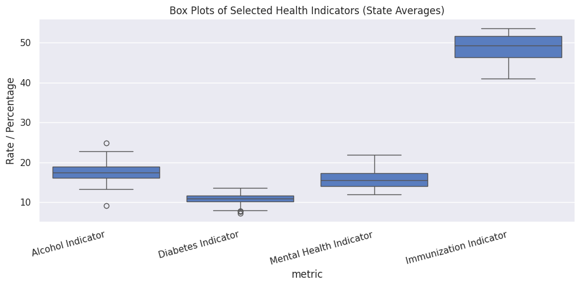
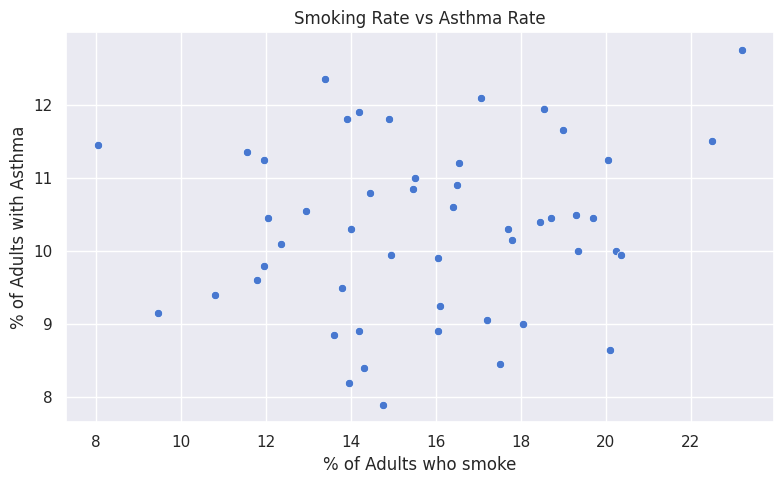
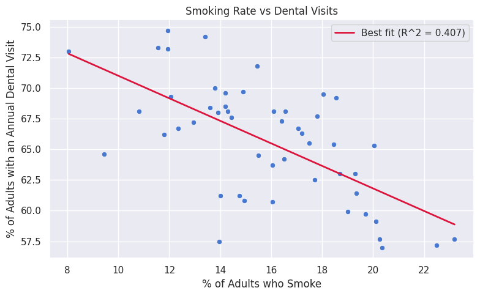
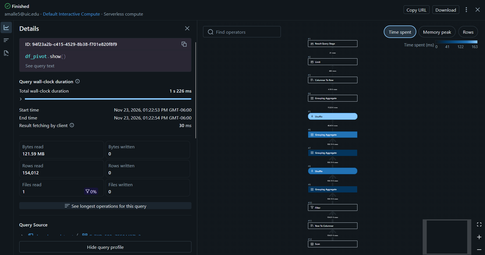
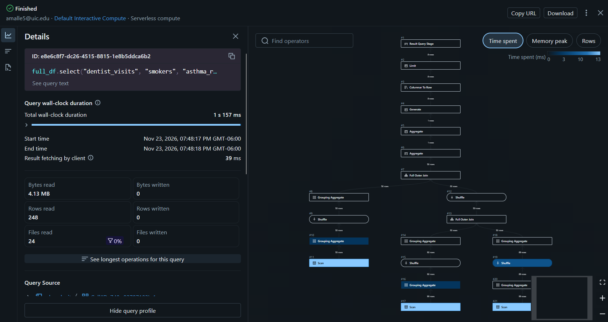

## Data Cleaning
The original dataset is a JSON file downloaded from https://catalog.data.gov/dataset/u-s-chronic-disease-indicators. Every row contained a question that the statistic answered, what state the statistic is derived from, the range of years where this statistic was compiled, the unit of the statistic, and the manner in which the statistic was stratified (on race, gender, age, etc.). This is a lot of different information that we thought might be better represented as columns so that we would not have to repeatedly filter the dataframe for each query. 

The data cleaning was performed on Databricks using Spark and the code can be found in eda_base_dataset/clean_base_dataset.ipynb. We first dropped all columns that we deemed to be irrelevant to our project's scope, and then tabulated the number of null values in the remaining columns. The only column with null values was "DataValue", so we dropped all rows in which it was null. We then dropped all duplicated rows, and ensured that the DataValue column was fully numeric by trying to cast every value as a numeric type. For the categorical data, we looked over all of the distinct values in each column and ensured that we did not miss some non-null filler such as "NA". 

After completing this process, we felt confident that the dataset was clean. We completed the preprocessing by pivoting the dataframe such that each topic and stratification was its own column while still retaining descriptive statistics in each row such as "Question", "Topic", and "DataValueUnit".

## Feature Selection and Descriptive Statistics

Due to the large number of columns in the pivoted dataframe, we chose to only look at a few key features that we planned to use in the latter stages of our project. These features are the percentage of adults that smoke, the percentage of adults that have visited the dentist in the last 12 months (from the "YearEnd" listed in the row), and the percentage of adults with asthma. We were particularly interested in trying to understand if there were any correlations between cigarette smoking and dental visits and asthma respectively, since cigarettes are harmful for both teeth and the respiratory system. Since there are records for these statistics from multiple years, we decided to simply average them to retain all the information across the year range we have selected. As such, we were left with 50 records, one for each state, for each of these features.

The following is a table describing the summary statistics for each selected feature:
| Statistic | Dental Visits % | Smoking % | Asthma % | Alcohol % | Diabetes % | Mental Health % | Immunization % |  
| --- | --- | --- | --- | --- | --- | --- | --- |
| Mean | 65.67 | 15.81 | 10.30 | 17.60 | 10.81 | 15.91 | 48.67 | 
| Std Dev | 4.75 | 3.30 | 1.18 | 2.53 | 1.39 | 2.41 | 3.50 | 
| Minimum | 57 | 8.05 | 7.9 | 9.2 | 7.3 | 12.02 | 41.01 | 
| First Quartile | 61.4 | 13.8 | 9.4 | 16.08 | 10.1 | 14.05 | 46.29 | 
| Median | 66.3 | 15.5 | 10.3 | 17.5 | 10.97 | 15.42 | 49.18 | 
| Third Quartile | 68.5 | 18.45 | 11.25 | 19.18 | 11.7 | 17.3 | 51.75 | 
| Maximum | 74.7 | 23.20 | 12.75 | 24.83 | 13.55 | 21.86 | 53.6 | 

## Key Observations and Outlier Detection

To understand the distribution of the data and identify outliers we used box plots for all the features:

The boxplot implementation we used identifies any outliers as separate points, and here we can see there are no outliers. If we were to find any outliers, we would choose to keep them in the dataset. On small samples of only 50 states, such outliers would be statistically significant and could lead us to understanding the factors that contribute to such an extremely different statistic.

Some interesting observations from these box plots are the difference in ranges between dental visits and asthma. Dental visits are surely impacted greatly by economic factors which we will try to understand more through the machine learning portions of the project. However, it is quite surprising that asthma is a seemingly steady statistic across state lines, especially when smoking also seems to have a large range. The minimal differences in asthma is important to note for when we move on to the machine learning portion.

We were also interested in the relationships between different variables, particularly smoking's impact on asthma and smoking's impact on dental visits. To understand these relationships we created scatter plots:

Surprisingly, there is seemingly no relationship between smoking and asthma. Even though the range of asthma's distribution was quite small, we expected it to be tied to smoking in some way and this is clearly not backed up by the data. On the other hand, it seems that smoking and dental visits are negatively correlated. We are interested in exploring this correlation more in the machine learning portion, and we will try to find any underlying features that may explain this trend.

## Work Division

For the base dataset, Saifullah and Advait split the workload. They worked together on the data cleaning, but split the features selected and their visualizations. Advait completed the dental visits, smoking rate, and asthma rate features, while Saifullah completed the Diabetes, Mental Health, Alcohol and Immunization features.

## Spark Execution DAGs

Below are screenshots of Spark execution DAGs from the notebooks in which we executed our code on Databricks.

